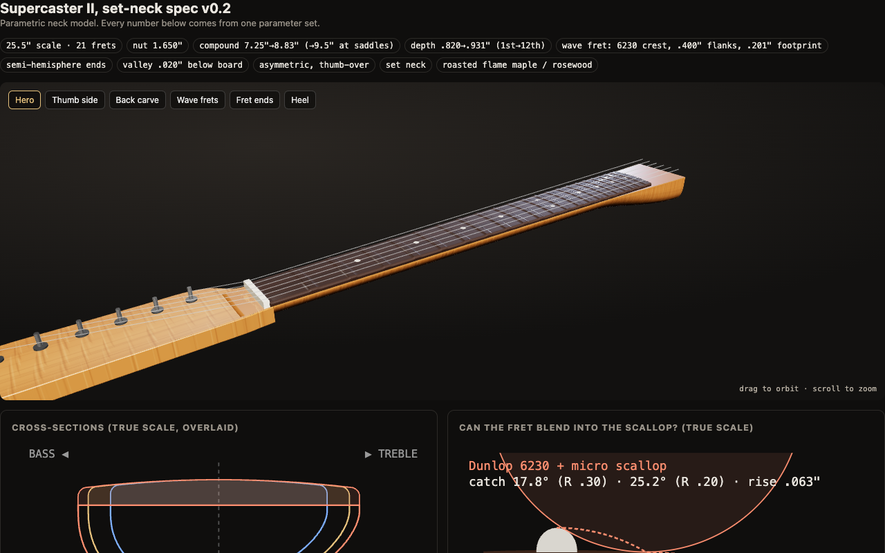
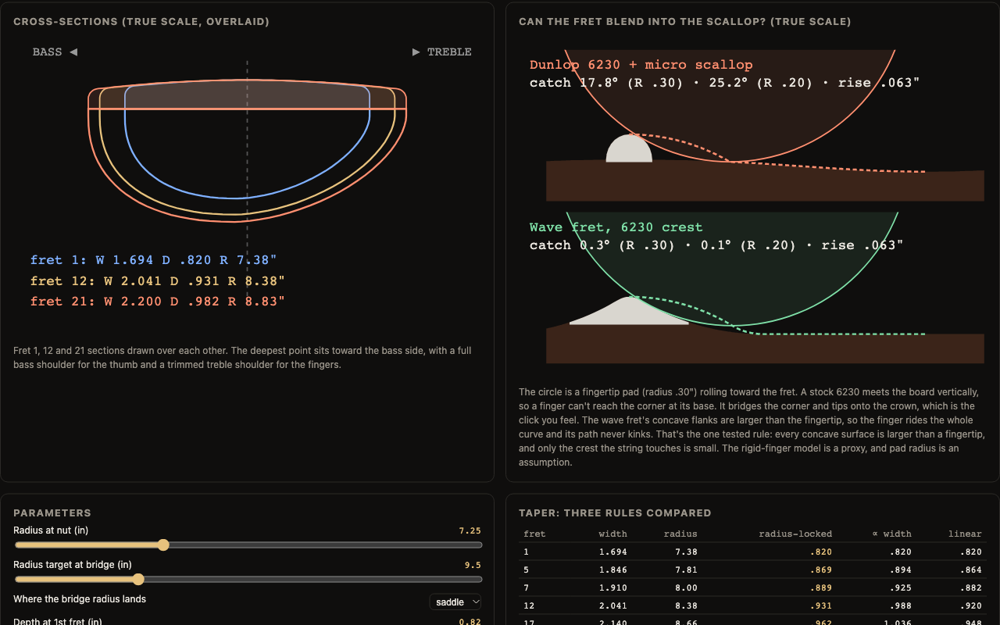
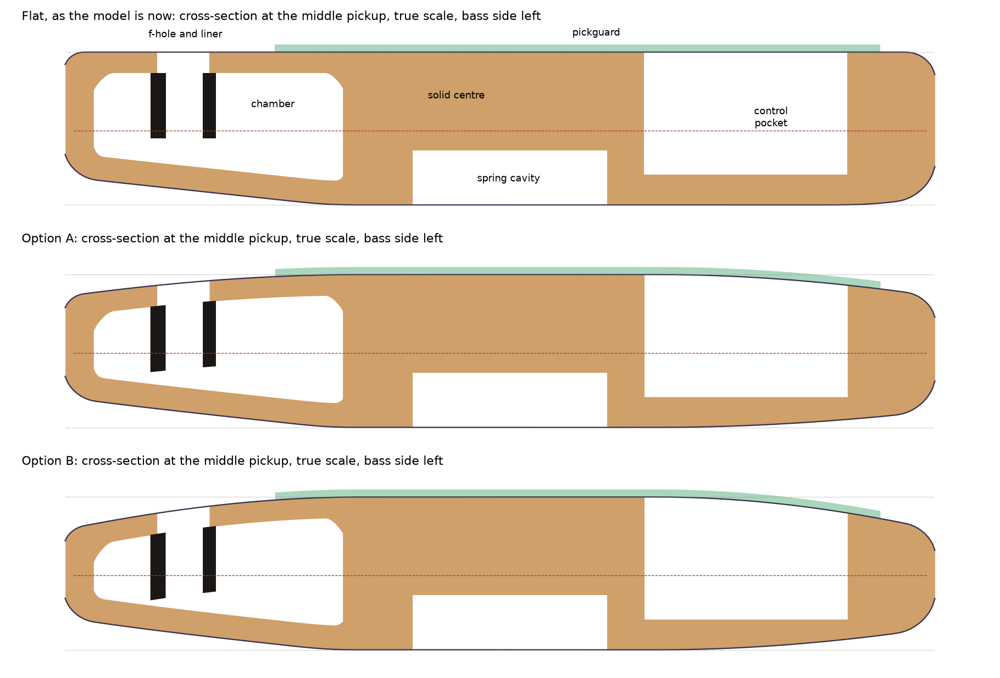

# Supercaster

[](https://github.com/MTADTA/supercaster/actions/workflows/checks.yml)

A guitar designed in code. The Supercaster is the chambered electric guitar I play. This repository is its CNC-ready
design, written as parametric models, with the simulation and checking scripts that drove the design decisions.

The simulations compare design options inside one model; they are not validated against a physical build
(`body/sim/MODEL.md` has the details). [OPEN-CALCS.md](OPEN-CALCS.md) lists the calculations still open.



## What is here

| Folder | What it is |
|---|---|
| `src/`, `neck/index.html` | Parametric neck model in JavaScript and a three.js viewer: orbit views, true-scale cross-sections, a fingertip comparison of fret profiles, live parameters, STL export. The STL is a display mesh of overlapping shells, not a machinable solid. The headstock in the viewer is a plain placeholder blank; the headstock is not designed yet. |
| `neck/` | The neck design studies in Python, v1 to v4: geometry laws, stiffness and relief checks, fret-end and scallop studies, nut break angle. `neck/v4/SPEC.md` is the current spec. |
| `body/carve/` | The body surface model: top carve, belly, edge law, chamber, routes, and the hard-constraint checks (`final_carve.py`). |
| `body/sim/` | A vibroacoustic model of the body: layered finite elements, a chamber air network, boundary-element radiation, and a reduced-order solve. |
| `body/optimize/`, `body/ergonomics/`, `body/acoustics/` | Reports and scripts: engineering status, plate and port study, weight and balance, wood properties, a tap-test procedure for the prototype. |
| `pickups/wiring/` | The control circuit's switching as a lug-level netlist, with a checker for all 60 switch states and a one-page diagram. `WIRING.md` is the design note. |



One example of how the work goes. The "wave fret" idea is a rule: every concave surface a finger can touch has a
radius larger than a fingertip, and only the crest the string touches is small. In the rigid-fingertip model in
`src/neck-geometry.js`, the angle at which a fingertip catches on the fret drops from about 15 to 25 degrees (a stock
narrow fret with a micro scallop) to 0.5 degrees or less. That model is a proxy and the fingertip radius is assumed, so
it is a reason to build a prototype, not a result.



## How to run it

**Neck viewer.** Serve the repository root and open the page. It loads three.js from a CDN, so it needs a network
connection.

```
python3 tools/build.py          # inlines src/neck-geometry.js into neck/index.html
python3 -m http.server 8000     # then open http://localhost:8000/neck/index.html
```

**Wiring check.** Standard library only.

```
cd pickups/wiring
python3 verify_switching.py     # prints "CHECKS: all 60 states pass" for each of three variants
```

**Neck and body Python.** Python 3.11 with the packages in `requirements.txt`. The body model also needs `pymetis`,
and `neck/v4/fret-ends/fe_render.py` needs `pyvista`.

```
python3 -m venv .venv && .venv/bin/pip install -r requirements.txt
cd neck/v4 && ../../.venv/bin/python neck_v4.py selftest
```

The reports say `cache/venv/bin/python`; that was the environment on my machine. Use your own.

**The body scripts need plan data that is not in this repository.** See "What is left out". Without it they load
`body/plan.sample.json`, which is synthetic sample data, and print a warning. What happens on the sample:

- `body/carve/final_carve.py` imports, prints its top-carve metrics, says the constraint checks need the real plan,
  and exits. The checks look for landmarks of my outline inside fixed windows, so they cannot run on the sample.
- `body/ergonomics/balance.py` stops with a message: it needs `body_final.npz`, a generated file that
  `body_fields.py` makes from the real plan.
- `body/sim/` imports and its unit test runs, but building the model on the sample fails for the same reason as the
  carve checks. `validate.py` stops with a message when there are no case results and leaves the stored
  `results/validation.json` alone.

So the body code here is for reading, not for reproducing my numbers. It also still contains parameters and search
windows that I tuned to the unpublished outline (where the belly cut sits, where the chamber wall runs, grid limits).

## How it is tested

Results on this tree, 2026-11-23:

| Check | Command | Result |
|---|---|---|
| Switching netlist, 60 states | `python3 verify_switching.py` in `pickups/wiring/` | all 60 states pass in each of the three variants; exit code 0; output identical to the stored `verify_switching.out` |
| Strength sizing | `python -m unittest` in `body/optimize/carve-v2-acoustics/` | 3 tests pass |
| Chamber geometry | `python -m unittest test_chamber_geometry` in `body/sim/` | 2 tests pass |
| Neck v4 self-test | `python neck_v4.py selftest` in `neck/v4/` | runs; prints computed values beside closed forms (for example cantilever tip 0.050000 against 0.050000) |
| Neck geometry module | loaded under Deno | loads; fret 12 at 12.75 in on the 25.5 in scale |
| Neck viewer | `neck/index.html` in headless Chrome | the page loads and draws the model, six view buttons and the parameter controls; the first image on this page is from an earlier run of the same page |
| Body carve on the sample plan | `python final_carve.py` in `body/carve/` | prints the top-carve metrics and exits cleanly before the constraint checks |

Not run here: orbiting and STL export in the viewer (nobody clicked them on this tree), the full body simulation, and
the figure scripts.

Before publishing I moved the plan-derived numbers out of the body code into the plan file. I then ran
`final_carve.py` and one build of the simulation model against my private plan file to confirm they still run to the
end. That run is not reproducible from this repository.

`body/sim/validate.py` compares the body model with the earlier study's numbers. The stored result
(`body/sim/results/validation.json`) is from my working tree, not from a run on this one, and it is a
model-against-model comparison, not a measurement. It cites reports under `final/` that are not in this tree.

Most of the checking in this project is in the reports: each one tags a number as computed, read in a named source,
or judged, and several were re-derived by a separate independent pass (`CHECK-*.md`).

## What is left out, and why

- **The body outline, hardware layout and tremolo routes.** The outline, pickguard, jack recess, screw, pickup and
  control positions I work from were traced from a third-party plan of a commercial guitar, and the tremolo route
  dimensions were measured from third-party plan sheets. None of those coordinates are in this repository, in code,
  comments or reports; where a report quoted them, the numbers were cut and the text says so ("x, y withheld"). The body code reads them
  from `body/plan.json` (or the path in `SUPERCASTER_PLAN`). To run it you supply that file in the format of
  `body/plan.sample.json`. The sample is made by `tools/make_sample_plan.py` from made-up numbers. It is not the design
  and numbers computed from it mean nothing.
- **What is still outline-dependent.** The f-hole polygon (`body/carve/fhole_trace.json`) is traced from my photo of
  my own guitar and sits in the same coordinate frame. One picture on this page is a cross-section of the real body
  model. Reports quote results (masses, areas, clearances, where a maximum falls) that were computed on the real
  outline.
- **The model of the original guitar and the product site.** Both are built on the same traced outline.
- **Plan PDFs and the notes measured from them, reference photos of other guitars,** and the studies that traced them.
- **Pickup coil data.** Pickup coil data is not published. The wiring folder therefore holds the switching logic
  only, and the scripts and results that depended on coil values (the hum and piezo-blend analyses and two independent
  re-checks of the wiring) are not in this tree.
- **Caches, result dumps, the Python environment, renders, meshes, audio, and the lighting image** used for renders.
  They are large, regenerated by the scripts, or not mine to share. Three small images are kept for this page.
- **The onboard preamp study and its audio demos, and the Blender render scripts.** The preamp study models named
  commercial circuits; the render scripts depend on the left-out outline and lighting image. Neither is part of this
  release.

Because of that, some reports mention scripts, figures, logs and other reports that are not in this tree.

The reports are working notes written between AI agents and me, and they are published as written apart from the cuts
above. They contain hand-off language ("questions for Jordan", "the body agent must update") and paths from my machine's
layout.

Code changes from my working tree, all made for this release: the body code reads the plan data, landmarks and tremolo
routes from a file (`body/carve/bodylib.py`, `final_carve.py`, `body/ergonomics/balance.py`, `body/sim/geom.py`,
`body/sim/model.py`); `final_carve.py`, `balance.py` and `validate.py` stop with a message instead of an error when
their inputs are missing; the viewer's headstock outline was replaced with a placeholder blank; `tools/build.py` builds
the neck page only; absolute paths became relative.

## Names and trademarks

The body outline is the familiar offset double-cutaway associated with the Stratocaster, and the reports compare this
design with that guitar and with other real products. Stratocaster, Strat, Telecaster and Fender are trademarks of
Fender Musical Instruments Corporation, which also claims rights in its headstock shapes. The headstock here is not
designed: the viewer draws a plain blank, and the Python mass models use a rough six-in-line placeholder polygon that
is not offered as a design. Other product names in the reports (tuners, fret wire, tremolos, suppliers) belong to
their owners and appear only as parts or cited sources. This is an independent personal project. It is not affiliated
with or endorsed by Fender or any other company named here.

## How it was made

I design, direct, test and decide what ships; AI coding agents write most of the code.

## Licence

No licence has been chosen yet. Until one is added, all rights are reserved.
