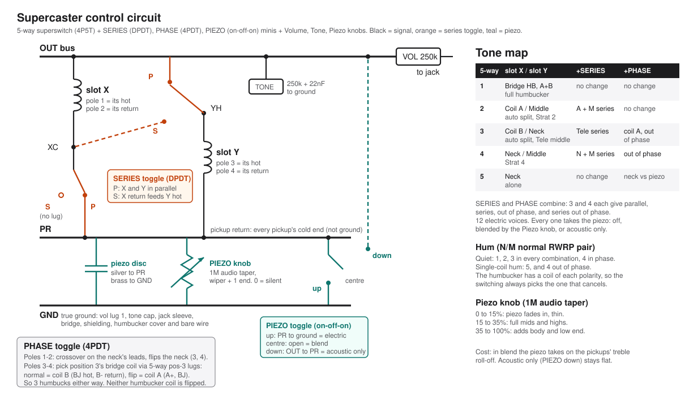

# Supercaster control circuit: 5-way, series, phase, piezo

Design note, 2026-11-22, cut down for publication on 2026-11-23. For the Supercaster prototype: neck and middle single coils and a bridge humbucker whose two coils are called A and B.

This note covers the switching only: which lug goes where, and which coils play in each switch state. Pickup coil data is not published, so this note has no coil values and no figures that depend on them (see §7).

Files:

- `diagram.svg` is the one-page diagram.
- `wiring_model.py` is the lug-level netlist (every solder joint) and a small circuit solver.
- `verify_switching.py` → `verify_switching.out` checks all 60 switch states against the tone map.

## 1. What the player gets

**Controls:**
- 5-way superswitch.
- Three minis: SERIES (DPDT), PHASE (**4PDT**) and PIEZO (on-off-on).
- Three knobs: Volume, Tone and Piezo.

| 5-way | Normal | SERIES on | PHASE on | SERIES + PHASE |
|---|---|---|---|---|
| 1 | Bridge humbucker, full (A+B) | no change | no change | no change |
| 2 | Coil A + middle, parallel (auto split) | A + middle in series | no change | as SERIES |
| 3 | Neck + **coil B**, parallel: the Tele middle, humbucking (auto split) | Neck + B in series, the "4-way Tele" sound | Neck + **coil A** out of phase (the coil changes by itself) | Neck + A in series, out of phase (Brian May) |
| 4 | Neck + middle, parallel | Neck + middle in series | Neck + middle out of phase | Series out of phase |
| 5 | Neck | no change | no audible change alone. With the piezo blended, it flips the neck against the piezo | as PHASE |

That is 12 distinct electric voices, all humbucking except the neck alone and position 4 out of phase. Each one can take the piezo:

- **PIEZO up:** electric only.
- **PIEZO centre:** piezo blended in. The Piezo knob sets how much.
- **PIEZO down:** acoustic only. The Piezo knob is its level.

There are three rules to remember:

1. The 5-way picks the pickups. Whenever the humbucker shares with another pickup, it splits by itself to the coil that cancels hum with its partner. There's no push-pull.
   - Coil A plays with the middle.
   - Coil B plays with the neck.
   - Coil A plays with the neck when PHASE flips it.
2. SERIES and PHASE only act when two pickups are on. SERIES joins the pair end to end. PHASE flips the neck.
3. The piezo adds to everything. The Piezo knob at zero is the same as the piezo being off.

## 2. How it works

The superswitch's four poles fill two "slots".

| Pole | Job | Pos 1 | Pos 2 | Pos 3 | Pos 4 | Pos 5 |
|---|---|---|---|---|---|---|
| 1 (common → OUT) | slot X hot | A+ | A+ | P3HOT | N+ | N+ |
| 2 (common → XC) | slot X return | — | BJ | P3RET | N− | — |
| 3 (common → YH) | slot Y hot | — | M+ | N+ | M+ | — |
| 4 (common → PR) | return to PR (slot Y, or a lone pickup) | B− | M− | N− | M− | N− |

Pickup leads:

- **A+:** the humbucker's hot end, on coil A.
- **BJ:** the humbucker's series link, where coil A meets coil B.
- **B−:** the cold end of coil B.
- **N+ / N−:** the neck's two leads after the PHASE toggle.
- **M+ / M−:** the middle's hot and return.
- **P3HOT / P3RET:** position 3's bridge coil, picked by PHASE poles 3 and 4 (below).

Lugs that share a name are jumpered together, as on a stock Strat switch. For example, pole 1 lugs 1 and 2 are both A+.

**SERIES toggle** (DPDT on-on):

- **Pole a:** common YH. P → OUT, S → XC.
- **Pole b:** common XC. P → PR, S → no connection.

In parallel, both slots run from OUT to PR. In series, slot X's return feeds slot Y's hot. In positions 1 and 5 the lone pickup returns through pole 4. That leaves XC and YH empty, so the toggle has nothing to join and the pickup plays normally. This is the detail that makes "any two in series" fit on a 4-pole switch.

**PHASE toggle** (4PDT on-on, all four poles throw together):

| Pole | Common | Normal | Flip |
|---|---|---|---|
| 1 | neck lead 1 | N+ | N− |
| 2 | neck lead 2 | N− | N+ |
| 3 | P3HOT | BJ (coil B's hot) | A+ (coil A's hot) |
| 4 | P3RET | B− (coil B's return) | BJ (coil A's return) |

Poles 1–2 are a crossover that flips the neck. Poles 3–4 are wired only to the superswitch's position-3 lugs, so they do nothing anywhere else. Neither humbucker coil is ever flipped, so the humbucker's own hum cancelling is never disturbed.

**Auto split.** The unused humbucker coil is left with one end open and passes no current:
- In position 2, pole 2 takes the return from BJ, so B− floats and coil B is off.
- In position 3 with PHASE normal, the bridge coil is B (BJ hot, B− return), so A+ floats and coil A is off.
- In position 3 flipped, the bridge coil is A (A+ hot, BJ return), so coil B is off.
- In position 1, pole 4 takes B− to PR and the whole humbucker plays.

**Why coil B in position 3.** The neck and middle are a normal RWRP pair, and coil A is opposite the middle, which makes coil A the same polarity as the neck. Neck + A therefore can't cancel hum in phase. Coil B is the other polarity by construction, so it does. Once PHASE flips the neck, the same logic picks coil A. Position 4 doesn't use the humbucker.

**PIEZO toggle** (SPDT on-off-on, or one pole of a DPDT on-off-on), common = PR:

- **Up:** to ground (piezo shorted, electric only).
- **Centre:** open (blend).
- **Down:** to OUT (pickups shorted, piezo only).

**Piezo and knob.** The disc's silver face goes to PR and the brass face to ground. The 1M audio-taper knob is wired as a rheostat, PR to ground. Use lug 1 and the wiper, with lug 3 free, so that resistance rises as you turn clockwise.

**Volume 250k** goes from OUT to ground, with the wiper to the jack. **Tone 250k + 22 nF** goes from OUT to ground. Both are masters and act on the piezo too.

## 3. Why the piezo goes in the return leg

The usual way to add a piezo is to run it through a 1M pot onto the output bus, in parallel with the pickups. A disc is a capacitor of some tens of nanofarads, so in parallel it sits across the pickups like a very large tone cap, and the pickups in turn load the disc.

This design puts the disc **in series** with the pickups, between their return (PR) and ground.

- The pickups see the disc as a series capacitor instead of a shunt one.
- The disc sees the volume pot and amp load instead of a pickup.
- The knob shunts the disc. At 0 Ω, PR is ground and the electric circuit is exactly the stock one. Turning the knob up only adds piezo.

What the switching checker confirms about this (it uses resistive stand-ins, so it says nothing about tone):

- PIEZO up removes the piezo from every position.
- PIEZO down removes the pickups from every position.
- In the centre, the piezo reaches the output in every position alongside the selected coils.

Two expected costs of the series arrangement follow from the topology. In blend, the disc's signal reaches the output through the selected coils, so the piezo takes on their treble roll-off and its colour changes with the 5-way; acoustic only (PIEZO down) bypasses the coils. And while the piezo is blended, the pickups work through the disc's capacitance, which trims their lowest bass; a larger disc, or two in parallel, trims less. The size of both effects depends on the pickups and the disc. The AC analysis that put numbers on them is not part of this release, and no script in this tree checks them.

## 4. Hum

Two in-phase coils cancel hum only if their magnets are opposite. Three single coils can't all cancel in pairs. The humbucker gets round that because it has a coil of each polarity, and the switching always picks the one that cancels.

Polarity assumed: neck and middle are a normal RWRP pair, and coil A is opposite the middle. That's how an HSS Strat with a split position 2 is normally set up. Check with a polarity tester before soldering.

| Quiet | Single-coil hum |
|---|---|
| 1; 2 parallel and series; 3 in all four SERIES/PHASE combinations; 4 in phase, parallel and series | 5 (it's one single coil); 4 out of phase, parallel and series |

Position 4 out of phase can't be fixed. Neck and middle have opposite magnets, so flipping one makes their hum add. Only a third coil could cancel it, and that would add its signal to the sound. "Hum" here means one single coil's level, the same as position 5.

This table is a polarity argument. `verify_switching.py` treats the four coils as identical, so "quiet" means the hum shares cancel exactly in that idealised model. How deep the cancellation is with real, unequal coils is not covered here.

`verify_switching.py` also runs two alternatives for comparison: position 3 always on coil A, and position 3 always on coil B. With coil A always, position 3 in phase hums. With coil B always, position 3 out of phase hums. The 4PDT PHASE toggle is what makes position 3 quiet both ways.

## 5. Build notes

- **Map the superswitch with a meter first.** The tables name lugs by pole and position (1 = bridge). Lug layouts differ between makers and with which way the switch is fitted, so find each pole's common and its position-1…5 lugs by continuity.
- **Nothing on the pickup side may touch ground.** Every pickup's cold end goes to PR, not ground. True ground gets:
  - the humbucker's cover, baseplate and bare wire;
  - the cavity and guard shielding;
  - the bridge/trem claw wire.

  If the humbucker has a bare wire soldered to a coil lead, separate them. The neck must be a plain 2-wire pickup with nothing grounded, because PHASE reverses it.
- **Shield properly.** While the piezo is blended, PR is not at ground: it sits above it by the impedance of the disc and knob. The coils are then more sensitive to electric (capacitive) hum than in a normal Strat. Foil the cavity and the guard, shield the pickups to true ground, and run the disc on shielded cable with the shield to ground.
- **The unused humbucker coil hangs off a live node.**
  - Position 2: coil B hangs off BJ.
  - Position 3, normal: **coil A hangs directly off the output.** BJ is the hot.
  - Position 3, flipped: coil B hangs off BJ.

  No current flows in it. Its winding does sit at signal level, though, which adds to the bridge pickup's exposure to electric buzz. **Foil-shield both coils to true ground, or fit a grounded cover.** Then compare buzz, hands off the strings, in position 3 against position 2. If 3 is clearly buzzier, the shield isn't doing its job.
- **Coil A must be the coil on the hot end (A+).** If the humbucker was built with B on the hot end, relabel: the two ends of coil A go where A+ and BJ are listed. Coil B's hot is then the junction, BJ, which is what the in-phase test below must confirm.
- **Phase-check coil B against the neck.** Clip-lead neck + B in parallel and tap the strings. It must sound full, not thin. If it's thin, swap P3HOT and P3RET's normal throws (BJ ↔ B−). That would mean the humbucker's internal link is the other way round from this note.
- **The PHASE toggle is a 4PDT mini.** These are standard guitar parts, for example Allparts EP-4363 and the Parts Express 060-524. They fit the same 1/4" hole as a DPDT mini, but the body is about twice as long, so check the depth and clearance under the guard. If its poles don't all throw at exactly the same instant, the flip can make a brief extra click.
- **Polarity test, piezo vs pickups.** Disc polarity against the magnetics isn't predictable.
  1. In position 5 with PIEZO in the centre, play with PHASE up, then down. PHASE flips the neck against the disc, so this is a free A/B.
  2. If the "down" setting sounds fuller, reverse the disc in the other positions as well, by swapping its leads. The brass face then becomes the hot side, so shield over it.
- **Bench test before closing up.** Measure DC resistance at the jack with volume on 10 and PIEZO up:
  - Position 1: coil A plus coil B.
  - 2, 3, 4: the two selected coils in parallel, or their sum with SERIES on.
  - 5: the neck alone.
  - The 250k volume pot sits across every reading, which pulls each one down a little.
  - With PIEZO in the centre, the knob's resistance adds to every reading, because the disc is open at DC. Turn the knob to 0 and the readings return to the PIEZO-up values.
  - With PIEZO down, the jack reads the knob's resistance in parallel with 250k.
- **Hum check in blend.** Compare hum with PIEZO in the centre and the knob at about half against PIEZO up. If the blended setting is clearly worse, improve the shielding before blaming the circuit.

## 6. Choices made, and the plain alternative

| Choice made here | Why | Plain alternative |
|---|---|---|
| Piezo in series with the pickups' return, knob as a shunt rheostat | The disc is not a shunt across the pickups, and the pickups are not a load across the disc (§3) | Parallel blend via the 1M pot |
| PIEZO is a 3-position on-off-on (electric / blend / acoustic only) | Gives the "electric to acoustic" voice for the price of the same mini | Use an on-on: up = off, down = blend |
| Piezo blends with every position, humbucker included | Same wiring, no extra parts | — |
| PHASE flips the neck | Leaves the humbucker's own cancelling alone. Gives the classic out-of-phase neck + bridge and neck + middle sounds | Flipping the middle instead makes positions 2 and 4 out of phase and 3 in phase only |
| **Position 3 uses coil B; PHASE is a 4PDT that swaps to coil A when flipped** | Position 3 cancels hum in all four combinations with no pickup rework | Position 3 always neck + coil A on a DPDT PHASE, which hums in phase. Or DPDT with coil B always: then 3 out of phase hums |
| SERIES does nothing in positions 1 and 5 | Every superswitch pole is in use. "Series = join the selected pair" stays a simple rule | — |
| No push-pull | Auto split replaces it | Free for a later feature |
| Volume 250k, tone 250k + 22 nF | The usual single-coil values | 500k volume |

## 7. Verification, and what is not here

- **What is checked.** `verify_switching.py` builds the lug-level netlist and checks every one of the 60 states (5 positions × SERIES × PHASE × 3 PIEZO settings), for the design and for the two position-3 alternatives. Every coil is a 1 kΩ resistor and the piezo a 10 kΩ one, so it is a test of topology only. It confirms:
  - which coils play, and whether each pair is in series or parallel and in or out of phase;
  - that PIEZO up removes the piezo and PIEZO down removes the pickups;
  - that only the selected humbucker coil plays in positions 2 and 3.

  It passes all 60 in each of the three variants. `verify_switching.out` is the stored output.
- **What is not published.** Pickup coil data is not published. The scripts and results that used it are therefore not in this tree: the AC analysis of the piezo blend, the hum figures for unequal coils, and two independent re-checks of the wiring by a separate agent, whose models had the coil values built in.
- **Not verified at all:**
  - anything on a real guitar; this circuit has not been built;
  - the disc's capacitance and mounting;
  - how neck + coil B sounds as the position-3 voice (§8).

## 8. Open decisions

1. **Listen to neck + coil B before soldering.** This is the gate for the whole position-3 scheme. Clip-lead neck ‖ B and neck ‖ A and compare them as the Tele position. If neck + A wins, rewire pole 1 lug 3 to A+ and pole 2 lug 3 to BJ, and use a DPDT PHASE. Position 3 in phase then hums.
2. **Disc size and count.**
3. Whether to use a push-pull for anything, now that the auto split has replaced it.
